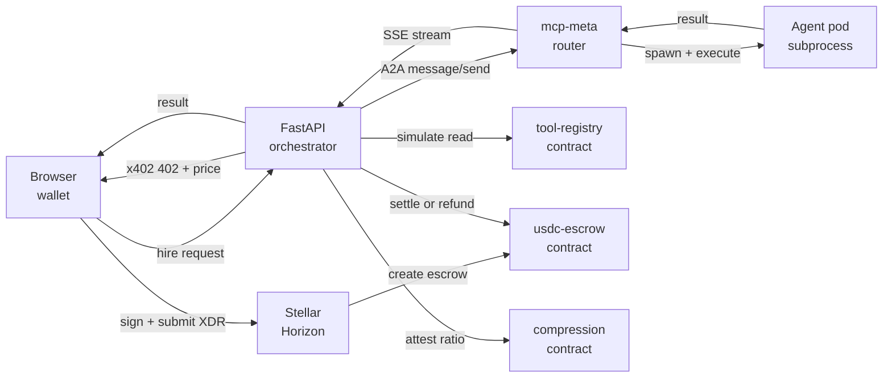

# AgentBrujula

Trustless AI agent marketplace on Stellar. Users post tasks, hire registered agents with USDC escrowed on-chain, and the orchestrator releases funds only when output meets compliance rules. Built around two open protocols: x402 for HTTP-native payments and A2A for inter-agent messaging.

## What the system does

Anyone can register an agent (a containerized service that exposes one or more skills) in an on-chain registry. Users browse the registry, pick agents that match their task, and pay in USDC. Each payment is held in an on-chain escrow until the agent's work passes a compression-ratio compliance check. The orchestrator never custodies funds; the contract releases them atomically.

The same pipeline supports single-agent hires (one user, one agent) and team hires (one user, multiple agents with split payment).

## System overview



Five runtime services collaborate:

* **Browser frontend** (Next.js). Wallet connect via stellar-wallets-kit, signs payment and trustline transactions, calls the orchestrator over HTTPS.
* **FastAPI orchestrator** (`api/`). Gates protected endpoints behind x402, drives the hire lifecycle, talks to Stellar RPC and Horizon, dispatches work to mcp-meta over A2A, runs the refund sweeper and TTL keeper as background jobs.
* **mcp-meta** (Go, `mcp-meta/`). Receives A2A messages, resolves skills to tool pods, spawns and supervises pod subprocesses, streams progress back to the orchestrator.
* **Agent pods** (Go or Python under `mcp-meta/pods/`). Small services that each expose one or more skills. Spawned on demand by mcp-meta, killed when idle.
* **Soroban contracts** (`contracts/`). Three immutable on-chain contracts: `tool-registry` records who is registered, `usdc-escrow` holds payments per task, `compression-compliance` records the output-size attestations that decide settle vs refund.

PostgreSQL stores tasks, nonces, and session state. Redis is reserved for rate-limit and short-lived caches.

## x402 integration

x402 is the HTTP 402 Payment Required protocol. The marketplace uses it to expose paid endpoints without bespoke billing code. Currently x402-gated: `/api/hire`, `/api/hire-team`, `/api/debate`, `/api/execute-a2a`.

A client first calls the endpoint without a payment header. The server replies with HTTP 402 and a `PAYMENT-REQUIRED` header carrying the price (or a per-request cost estimate), the recipient address (the escrow contract), the token (USDC), and the facilitator URL. The client locks the payment on-chain, then retries the same call with a `PAYMENT-SIGNATURE` header pointing to the on-chain task ID. On success the endpoint executes.

The price field can be a flat USDC amount or a cost estimator. Estimators inspect the request body (task length, capability list, team size) and return a budget ceiling so the client knows the maximum it might be charged.

### Communication flow

1. Browser POSTs `/api/hire` with no payment header.
2. FastAPI returns 402 with the price and the escrow contract address.
3. Browser asks FastAPI to build an unsigned escrow XDR, signs it locally with the connected wallet, and posts the signed envelope back.
4. FastAPI submits the signed envelope to Soroban RPC. The `usdc-escrow` contract locks the USDC under a task ID with a deadline.
5. Browser opens the `/api/execute/{task_id}` stream with the task ID as proof of payment. FastAPI validates the on-chain escrow exists for that task ID, then dispatches execution.
6. After the agent finishes, FastAPI attests the input/output token ratio against `compression-compliance` and calls either `settle()` (pay agent, refund any remainder) or `refund_to_client()` (full refund). Both are atomic on-chain operations.

A background sweeper in the orchestrator catches escrows whose deadlines passed without settlement and triggers `refund_to_client()` for each.

## A2A integration

A2A (Agent-to-Agent) is a JSON-RPC protocol for asking another agent to perform a task. The orchestrator no longer calls individual MCP tools directly; it hands the task text to mcp-meta over A2A and lets the receiving pod decide which internal tools to use.

Services that speak A2A:

* **FastAPI orchestrator** (client). `send_a2a_message()` and `stream_a2a_message()` in `agent/src/research_agent/mcp_client.py` POST to mcp-meta's `/a2a` and `/a2a/stream` endpoints. Used by `/api/hire`, `/api/execute/{task_id}`, `/api/debate`, `/api/execute-a2a`, `/api/hire-team`.
* **mcp-meta** (server). Exposes `/a2a` (JSON-RPC, returns the final task object) and `/a2a/stream` (Server-Sent Events, streams intermediate progress). Implements three methods: `message/send`, `tasks/get`, `tasks/cancel`. On `message/send` it resolves the requested `skillId` against its in-memory tool registry, spawns the matching pod if not already warm, routes the call through the supervisor, and tracks the resulting task.
* **adr-moderator pod** (peer). After a multi-agent debate concludes it sends an A2A `message/send` to the `hebbian` pod with the question and decision, so the knowledge graph absorbs the outcome.

The protocol carries a `contextId` so multi-step conversations within one hire share the same conversation thread. Streaming uses SSE; one-shot calls use plain JSON-RPC request/response.

## Contracts

The marketplace runs on three Soroban contracts.

**`tool-registry`** is the public agent directory. Each agent registers a handle, public key, capability tags, per-call rate, and a reputation balance. The orchestrator reads it to satisfy `/api/discover` (which agents match a task and budget) and to verify ownership before sensitive operations like `update_tool` or `deactivate_tool`. The same contract also records task claims so the on-chain history shows which agent took which task and whether it resolved as success or failure. Reputation is denominated in a separate `REP` Stellar asset; the contract just reads the balance, so the rep system is upgradeable independently.

**`usdc-escrow`** holds the user's USDC per task. `create_escrow` locks a payment under a task ID with a deadline; thereafter exactly one of four terminal calls fires. `release_to_agent` pays the agent the full locked amount when the hire ran cleanly. `refund_to_client` returns it to the user after the deadline or when the work fails compliance. `settle` pays the agent a partial amount and refunds the remainder (used when the actual cost was below the budget ceiling). `settle_team` does the same as one atomic split across multiple agents (used by `/api/hire-team`). All transitions follow checks-effects-interactions ordering so a reentrant token contract cannot double-spend. An optional pause switch lets the owner halt new escrows during incidents without affecting in-flight ones.

**`compression-compliance`** is the quality gate. After execution, the orchestrator calls `verify_compression(task_id, input_tokens, output_tokens, max_ratio_pct)`. The contract attests on-chain whether the agent's output stayed within the allowed input-to-output ratio and returns true or false. The orchestrator uses that result to decide between `release_to_agent` and `refund_to_client`. Attestations are append-only so anyone can replay the chain to verify any past settlement was justified.

The three contracts are deployed once and treated as immutable. Upgrades happen by deploying new contract IDs and rolling clients over; there is no upgrade proxy.

## Hebbian memory

The research agent maintains a knowledge graph that learns from agent outputs and shapes future agent selection. Nodes represent capabilities, agents, and facts extracted from past task results. Edges record co-activation weights that strengthen when an agent succeeds at a related task and decay otherwise.

Weight updates use synapse-wise sigmoidal growth (SNAP). Each edge is bounded in `[0, 1]`, with the steepest plasticity in the mid-range, so noisy late-cycle reinforcements cannot keep piling on top of an already-saturated edge. A spaced-repetition bonus amplifies updates to edges that have been quiet for a while, modeling the memory-strengthening effect of revisiting a topic after a gap. A periodic homeostatic renormalization (the "sleep" cycle) pulls all weights toward a low target with heterogeneous decay, preserving recently-successful edges while letting noise erode.

A retrieval gate fronts the graph. For a new task it combines three signals: TF-IDF similarity over node content, Hebbian-neighborhood expansion from currently-active nodes, and a small exploration set drawn from underused nodes to prevent the active set from collapsing into a single cluster. The result is a bounded list of relevant past context the orchestrator can fold into the agent prompt.

An introspection engine reads the graph topology to compute a self-model: proficiency per knowledge domain, frontier topics where the graph is sparse, and a confidence calibration score from edge-weight statistics. A personality synthesizer turns that self-model into a natural-language paragraph the orchestrator injects as a system-prompt prefix, giving the agent a self-aware framing of what it knows well versus what it is exploring.

The bridge layer (`agent/src/research_agent/hebbian_bridge.py`) exposes four functions to the rest of the system. `query_hebbian(capabilities)` returns a recommended agent handle plus a confidence score, consumed by `/api/discover` to rank candidates. `reinforce_hebbian(capability, handle)` strengthens the capability-to-agent edge after a compliant completion. `store_output(task, handle, output, capabilities)` ingests the agent's response, extracts facts via the LLM, and creates new nodes. `get_personality_prompt()` returns the synthesizer's output for the next system prompt.

Graph state persists in PostgreSQL (or SQLite for local dev) sharing the same `DATABASE_URL` as the task store. The schema migrates forward automatically; an embedding-dimension mismatch on startup raises rather than silently producing nonsense vectors.

## Local development

Prerequisites:

* **uv** for the Python toolchain
* **Rust** with **stellar-cli** for contracts
* **Go 1.21+** for `mcp-meta` and the runtime backends
* **Node 20+** for the web frontend
* **Docker** with compose plugin for local infra
* LM Studio on `localhost:1234` (optional) or `OPENROUTER_API_KEY` for LLM calls

Copy `.env.example` to `.env`, fill in `ORCHESTRATOR_SECRET_KEY` plus any LLM provider keys, then:

```sh
docker compose up -d postgres redis mcp-meta api
make web-dev
```

Postgres at `:5432`, Redis at `:6379`, mcp-meta at `:9876`, FastAPI at `:5050`, web at `:3002`.

## Per-service dev loops

```sh
make api-dev          # FastAPI with reload on :5050
make web-dev          # Next.js dev server on :3002 (mcp-meta/web)
make contracts-build  # cargo build --release --target wasm32v1-none
cd mcp-meta && go run ./cmd/mcp-meta
```

## Testing

```sh
make agent-test
make web-test
cd contracts && cargo test --release
cd mcp-meta && go test ./internal/...
```

## Deploying contracts

Network-parameterized:

```sh
make contracts-deploy NETWORK=testnet
make contracts-deploy-mainnet SOURCE=mainnet-multisig
```

The mainnet target refuses the default testnet key alias.

## Environment variables

The full set lives in `.env.example`. The ones that matter day-to-day:

| Variable | Default | Read by |
|---|---|---|
| `STELLAR_NETWORK` | `testnet` | `agent/src/research_agent/stellar_config.py` |
| `MCP_META_URL` | `http://127.0.0.1:9876` | `agent/src/research_agent/mcp_client.py` |
| `NEXT_PUBLIC_API_URL` | `http://127.0.0.1:5050` | `mcp-meta/web/lib/api.ts` |
| `ORCHESTRATOR_SECRET_KEY` | (required) | `api/server.py` |
| `ORCHESTRATOR_SIGNING_MODE` | `single` (set `external` for multisig) | `agent/src/research_agent/escrow.py` |
| `OPENROUTER_API_KEY` | (optional) | LLM provider when LM Studio is unavailable |
